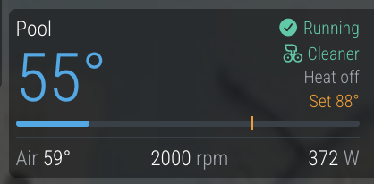

# MMM-nodejs-pool

MagicMirror² module for [nodejs-poolController](https://github.com/tagyoureit/nodejs-poolController).
Shows water and air temperature, pump speed and power, heater and set point, and cleaner status.



## Install

```sh
cd ~/MagicMirror/modules
git clone https://github.com/emlowe/MMM-nodejs-pool
```

No npm dependencies.

## Config

```js
{
  module: "MMM-nodejs-pool",
  position: "top_right",
  config: {
    hostname: "192.168.1.50:4200", // nodejs-poolController host and port
    updateInterval: 120000,
    tempMin: 40,  // left end of the temperature bar
    tempMax: 110  // right end
  }
}
```

The panel switches to the spa when it's on, and shows **Off** when neither pool nor spa is running.
